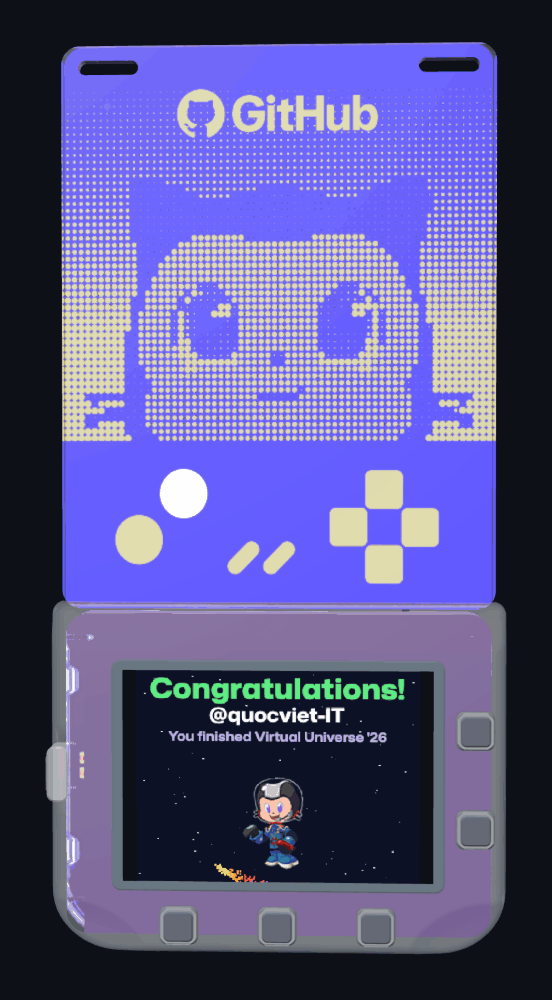

## 🐍 Contribution Activity

<picture>
  <source media="(prefers-color-scheme: dark)" srcset="https://raw.githubusercontent.com/quocviet-IT/quocviet-IT/output/github-snake-dark.svg" />
  <source media="(prefers-color-scheme: light)" srcset="https://raw.githubusercontent.com/quocviet-IT/quocviet-IT/output/github-snake.svg" />
  
</picture>

<picture>
  <source media="(prefers-color-scheme: dark)" srcset="https://raw.githubusercontent.com/quocviet-IT/quocviet-IT/output-3d/profile-halloween-dark.svg" />
  <source media="(prefers-color-scheme: light)" srcset="https://raw.githubusercontent.com/quocviet-IT/quocviet-IT/output-3d/profile-halloween-light.svg" />
  
</picture>

  <picture>
    <source media="(prefers-color-scheme: dark)" srcset="https://streak-stats.demolab.com/?user=quocviet-IT&background=0D1117&border=30363D&stroke=30363D&ring=FA7A18&fire=FA7A18&currStreakNum=A371F7&currStreakLabel=A371F7&sideNums=E6EDF3&sideLabels=E6EDF3&dates=9198A1" />
    <source media="(prefers-color-scheme: light)" srcset="https://streak-stats.demolab.com/?user=quocviet-IT&background=FFFFFF&border=D0D7DE&stroke=D0D7DE&ring=FE9600&fire=FE9600&currStreakNum=6E40C9&currStreakLabel=6E40C9&sideNums=1F2328&sideLabels=1F2328&dates=59636E" />
    
  </picture>

## 🛠️ Tech Stack & Tools

  
  
  
  
  
  
   
  
  
  
  
  
  
   
  
  
  
  
  
   
  
  
  
  
  
  
  

## 🏅 Badges

  

